# Government Sahayak - System Architecture & Entity-Relationship Design

## 1. Architectural Overview
Government Sahayak is architected as an offline-capable, bilingual (Telugu & English), voice-enabled welfare scheme guidance platform. The system strictly separates **deterministic eligibility rule calculation** from **generative text responses**:
- **Eligibility Engine:** Decided by a three-valued logic engine running deterministically on both server and client without LLM hallucination.
- **RAG & Faithfulness Guard:** Grounded strictly in verified government documentation with an extractive chunk fallback whenever LLM hallucination or network drop occurs.
- **Speech Pipeline:** Primary on-device voice recognition and synthesis with seamless cloud fallback to Google STT/TTS and server audio streaming.
- **Data Synchronization:** Atomic offline cache synchronization via `/api/export` and `/api/meta/version`.

---

## 2. Entity-Relationship (ER) Diagram

```mermaid
erDiagram
    scheme_categories ||--o{ schemes : "contains"
    schemes ||--o{ scheme_benefits : "provides"
    schemes ||--o{ eligibility_rules : "governed_by"
    schemes ||--o{ required_documents : "requires"
    schemes ||--o{ application_steps : "guided_by"
    schemes ||--o{ government_sources : "cited_from"
    schemes ||--o{ known_discrepancies : "tracks"
    schemes ||--o{ help_requests : "referenced_in"

    scheme_categories {
        string id PK "Unique category slug (e.g. agriculture, pension)"
        string name_en "English category label"
        string name_te "Telugu category label"
    }

    schemes {
        string scheme_id PK "Unique scheme identifier (e.g. pm-kisan)"
        string category_id FK "References scheme_categories.id"
        string name_en "Scheme name in English"
        string name_te "Scheme name in Telugu"
        string scope "Scope: central or andhra_pradesh"
        string department "Issuing government department"
        text summary_en "Concise summary in English"
        text summary_te "Concise summary in Telugu"
        string last_verified "ISO date of official verification"
    }

    scheme_benefits {
        int id PK "Autoincrement primary key"
        string scheme_id FK "References schemes.scheme_id"
        int benefit_order "Display sequence"
        text benefit_en "Benefit description in English"
        text benefit_te "Benefit description in Telugu"
    }

    eligibility_rules {
        int id PK "Autoincrement primary key"
        string scheme_id FK "References schemes.scheme_id"
        int path_index "Logical OR path index"
        int rule_order "Logical AND rule sequence"
        string field "Target field in fields.json"
        string op "Operator: is, gte, lte, gt, lt"
        string value_str "Comparison threshold value"
        string kind "Rule kind: hard, list, advisory"
        text en "Rule explanation in English"
        text te "Rule explanation in Telugu"
    }

    required_documents {
        int id PK "Autoincrement primary key"
        string scheme_id FK "References schemes.scheme_id"
        string name_en "Document name in English"
        string name_te "Document name in Telugu"
        boolean required "True=Required, False=Optional, Null=Confirm at office"
    }

    application_steps {
        int id PK "Autoincrement primary key"
        string scheme_id FK "References schemes.scheme_id"
        int step_number "Sequential step number"
        text step_en "Step instructions in English"
        text step_te "Step instructions in Telugu"
    }

    government_sources {
        int id PK "Autoincrement primary key"
        string scheme_id FK "References schemes.scheme_id"
        string title "Official document title"
        string url "Secure HTTPS source URL"
        string source_type "official, government-portal, or secondary"
    }

    known_discrepancies {
        int id PK "Autoincrement primary key"
        string scheme_id FK "References schemes.scheme_id"
        text discrepancy_text "Documented variance between official portals"
    }

    help_requests {
        int id PK "Autoincrement primary key"
        string request_id "Unique tracking UUID"
        string scheme_id "Optional target scheme"
        text question "Citizen question"
        string language "Language: en or te"
        string contact_phone "Optional 10-digit mobile number"
        boolean consent "Explicit citizen consent"
        string status "Status: open, assigned, closed"
        string status_token "Secret lookup token"
        text response "Staff answer"
        string assigned_to "Staff username"
        datetime created_at "Timestamp"
        datetime updated_at "Timestamp"
    }

    staff_users {
        int id PK "Autoincrement primary key"
        string username "Unique login username"
        string password_hash "Argon2/Bcrypt password hash"
        string full_name "Full name of staff"
        string role "Role: admin or agent"
        boolean is_active "Active flag"
        datetime created_at "Creation timestamp"
    }

    device_tokens {
        int id PK "Autoincrement primary key"
        string fcm_token "FCM push token"
        string language "Preferred language: en or te"
        datetime created_at "Registration timestamp"
    }
```

---

## 3. Citizen Authentication Architectural Decision
Per Section 27.3:
Citizens use the app completely **without an account or login**.
- **Privacy Preservation:** Prevents gathering unnecessary personally identifiable information (PII) such as Aadhaar numbers, phone numbers, or passwords.
- **Zero Friction for Low-Literacy Citizens:** Eliminates password management, OTP dropouts in low connectivity areas, and barrier-to-entry for rural and elderly citizens.
- **Secure Token-Based Lookups:** Citizens track their individual helpdesk requests via a cryptographically random `status_token` stored locally on their device, ensuring privacy without requiring an account.
- **Staff Access:** Helpdesk staff authenticate using signed JSON Web Tokens (JWT) with 8-hour expiration and bcrypt/argon2 password hashing.
